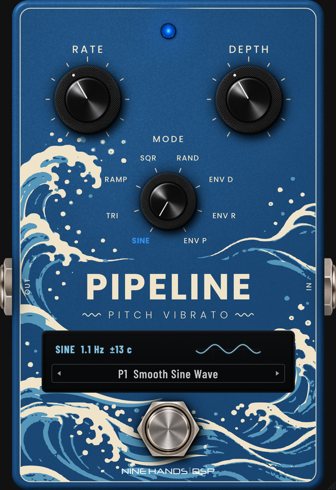

# Pipeline (NINE HANDS | DSP)

Plugin VST3 (Windows x64 et macOS universel) au format pédale simple : **vibrato de hauteur à 8 modes**, d'après le fonctionnement de l'**EarthQuaker Devices Aqueduct**. Nom dans le DAW : **Pipeline (NINE HANDS | DSP)**.

<p align="center">
  <a href="https://github.com/Nine-Hands-Dsp/pipeline/releases/latest/download/Pipeline-VST3-Windows.zip"></a>
  <a href="https://github.com/Nine-Hands-Dsp/pipeline/releases/latest/download/Pipeline-VST3-macOS.zip"></a>
  <br>
  <a href="https://github.com/Nine-Hands-Dsp/pipeline/releases/latest"></a>
</p>



## Installation

Les boutons ci-dessus téléchargent toujours la dernière version.

- **Windows** : décompresser `Pipeline-VST3-Windows.zip` et copier `Pipeline.vst3` dans `C:\Program Files\Common Files\VST3`.
- **macOS** : décompresser `Pipeline-VST3-macOS.zip` et copier `Pipeline.vst3` dans `~/Library/Audio/Plug-Ins/VST3` (si macOS le bloque : `xattr -cr ~/Library/Audio/Plug-Ins/VST3/Pipeline.vst3`).
- Reaper : Options > Préférences > Plug-ins > VST > Re-scan.

Notice : `docs/Pipeline_Notice_FR_v1.6.0.pdf`.

## Commandes

| Commande | Rôle |
|---|---|
| RATE | Vitesse du LFO, 0,1 Hz à 16 Hz (≈ 1,8 Hz à midi). Env R : sensibilité de l'enveloppe. Env P : sensibilité et amplitude du bend. En synchro tempo : valeur de note (4 mesures à 1/32, pointées et triolets). |
| DEPTH | Intensité du vibrato (retard jusqu'à 22 ms, écart de hauteur tenu vers +4 / -6 demi-tons). Env D : sensibilité de l'enveloppe. Env P : mélange sec / traité (midi = 50/50). |
| MODE | Sine, Triangle, Ramp, Square, Random, Env D, Env R, Env P (sélecteur à crans, clic direct possible sur l'étiquette, mode choisi allumé dans le bleu de la LED). |
| Footswitch | Flexi-Switch : appui bref = marche / arrêt, appui maintenu (> 0,45 s, effet coupé) = momentané. Fondu de 12 ms. |

## MIDI

MIDI Learn sur toutes les commandes (clic droit), sauvegardé avec le projet. **Aucun CC assigné par défaut.** CC 14 bits (CC n + n+32) ; Program Change 1-15 = presets d'usine. Pédales d'expression : rampe + lissage 2 pôles, course apprise automatiquement, zones mortes.

## Visuel

Fond `background.png` de 1235 x 1800 (pédale plein cadre, transparent seulement autour des jacks), calculé en 4K par `tools/make_art.py` : boîtier bleu océan, vagues de `design/source/Pipeline-vagues.svg`, écran. Les commandes et leurs ombres sont dans un calque séparé (`controls.png`) : potards moletés, LED bleue à facettes, footswitch d'Echoflex et embases jack (kit photo NINE HANDS | DSP). Textes (Poppins), graduations, cadre, vagues (`PipelineWaves.svg`) et logo (`NineHandsLogo.svg`) sont dessinés en vectoriel par le plugin, à la résolution physique de l'écran. Toutes les positions passent par `Layout.h`.

## Anti-gel v2

JUCE 8.0.15 ; rendu logiciel forcé sous Windows (réappliqué à chaque nouvelle fenêtre hôte), aucun calcul lourd dans `paint()` (caches refaits par le timer), chien de garde de redessin (1,5 s), aucun appel à l'hôte ni recherche par chaîne dans le thread audio (file atomique vidée par un timer à 60 Hz).

## Fichiers

- `PipelineDSP.h` : moteur audio (ligne de retard modulée, interpolation Hermite, suiveur d'enveloppe, fondu de têtes de lecture).
- `PluginProcessor.*`, `PluginEditor.*`, `Layout.h` (généré), `background.png`, `controls.png`, `glow_led.png`, `led_on.png`, `PipelineWaves.svg`, `NineHandsLogo.svg`.
- `tools/make_art.py` (+ `photo_controls.py`, `svg_render.js`) : visuel ; `tools/render/` : compile la vraie fenêtre sous Linux et exporte les captures ; `tools/manual.py` : notice PDF.
- `tests/test_dsp.cpp` : banc d'essai du moteur.

## Compilation

```
cmake -B build && cmake --build build --config Release
```
Le workflow GitHub `build.yml` produit les artefacts Windows et macOS et publie la Release (fichiers à nom fixe).

## Historique

- **1.6.0** : visuel entièrement refait au format NINE HANDS | DSP (1235 x 1800, plein cadre, rendu 4K, vagues / textes / graduations / logo vectoriels), potards moletés agrandis, LED bleue à facettes, mode choisi écrit dans le bleu de la LED, notice en français.
- **1.5.2** : notice avec Ampire et Impulse ; boutons de téléchargement et Release GitHub.
- **1.5.1** : plus aucun CC MIDI par défaut (MIDI Learn seulement) ; fabricant NINE HANDS | DSP.
- **1.5.0** : clic droit > Plugin size > Default size (new windows).
- **1.4.3** : potards et bloc MODE remontés, titres éloignés des potards.
- **1.4.2** : sélecteur MODE à crans comme Ring Think.
- **1.4.1** : étiquettes des modes agrandies et éteintes quand l'effet est coupé, nom des presets agrandi.
- **1.4.0** : étiquette du mode allumée, écran avec oscilloscope animé.
- **1.3.x** : footswitch d'Echoflex, potards moletés, footswitch MIDI à bascule.
- **1.2.0 / 1.1.0** : visuels « vagues ».
- **1.0.0** : première version.
